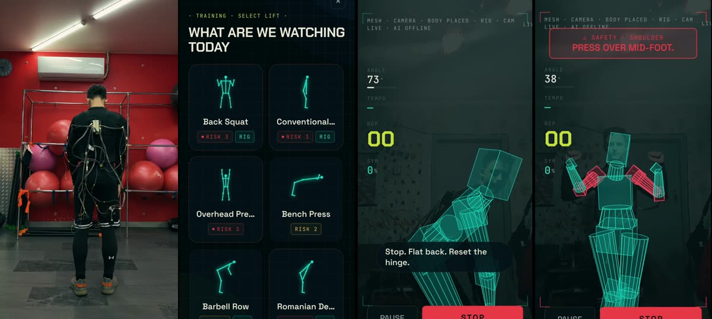
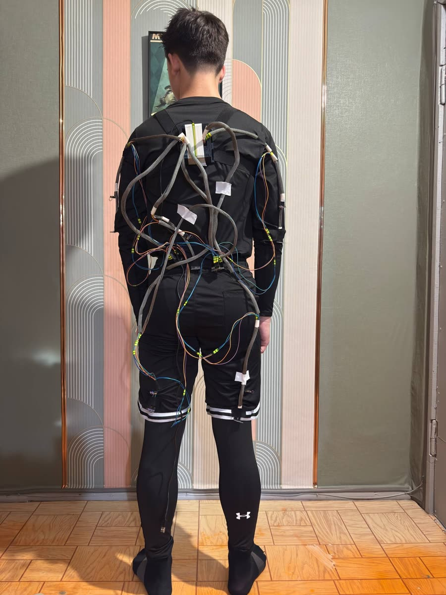
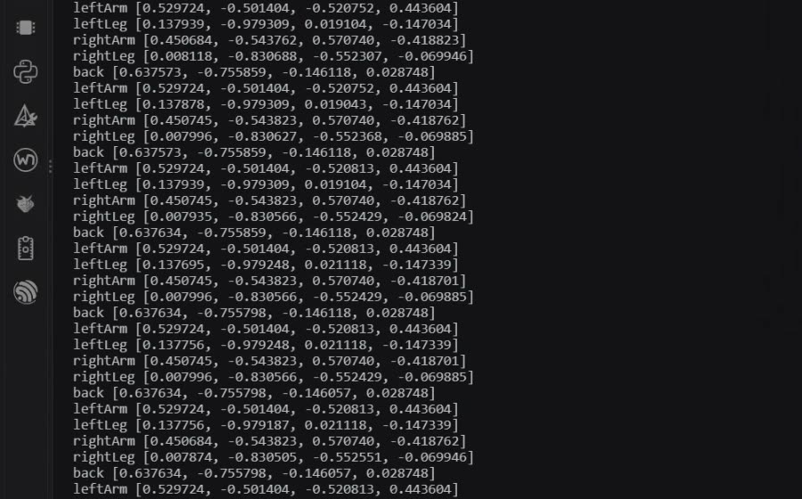
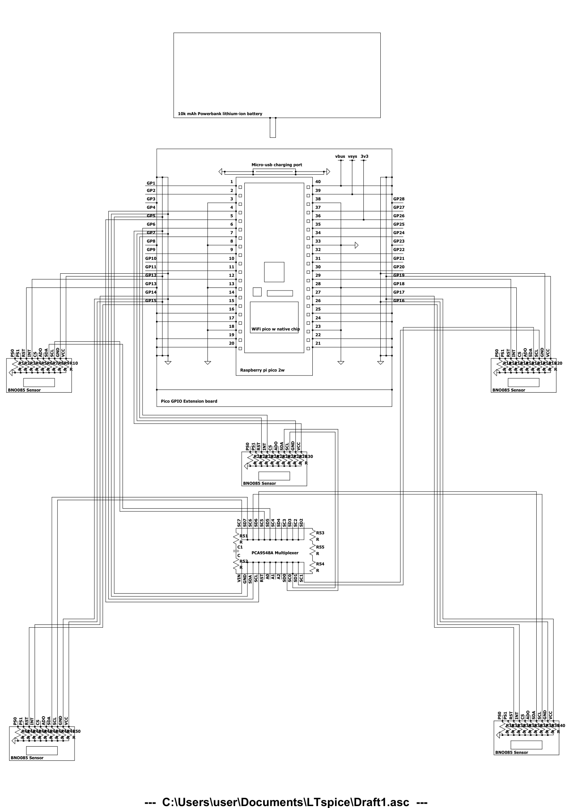
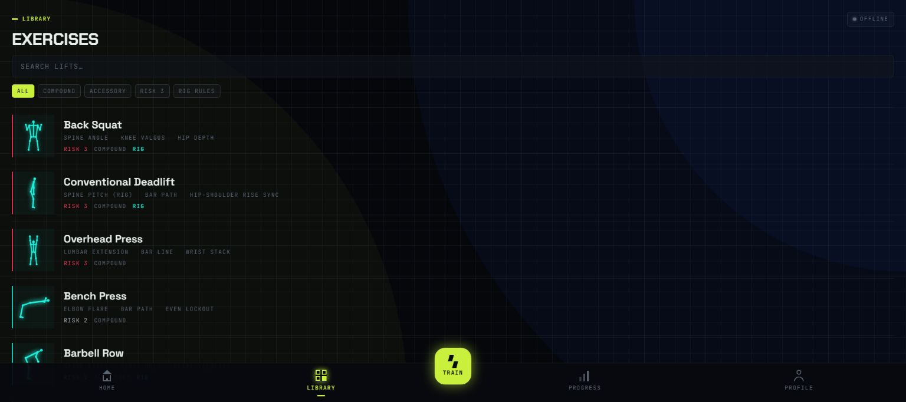
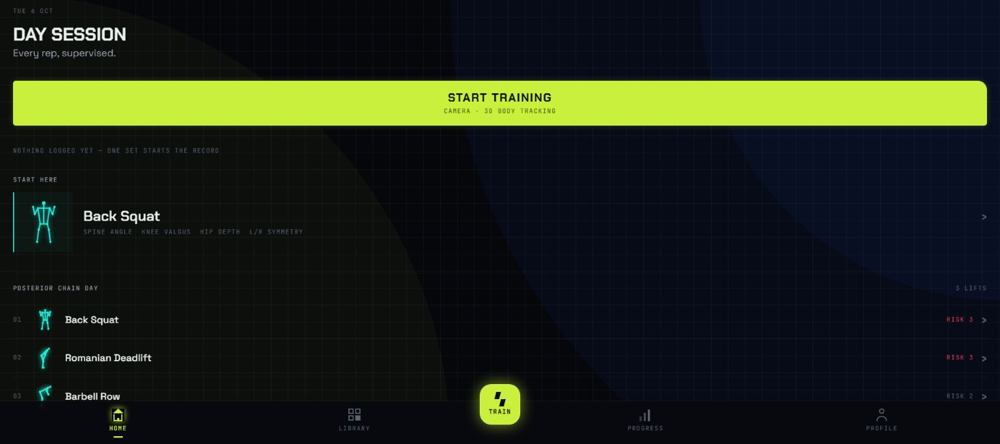
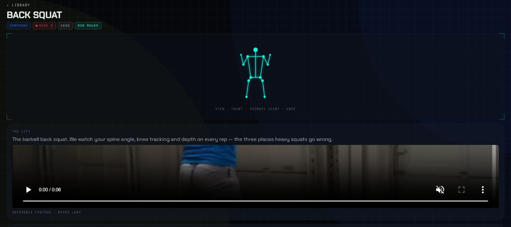

# Synapse
### Understand the movement while the set is still happening.

An exercise-analysis application built around a wearable sensor rig. Five IMUs on the body measure the movement, exercise rules turn those signals into feedback, and the phone camera shows the result on a 3D figure aligned with the user. The experience follows a real training session: choose a lift, learn what is being checked, put on the rig and review the set.

*The prototype suit in a gym, the lift library, the live 3D figure and a correction when form breaks.* ▶ [Watch the demo (MP4, 1:28)](synapse-demo.mp4)

## The project

Synapse is a startup project focused on highly specialised **movement-tracking suits**. The suit is meant to help not only people who coach themselves, but also local — and possibly global — **rehabilitation centres and gyms**, acting as a mechanical trainer or occupational therapist.

### The problem

- **Wrong technique is a quiet cause of training injuries.** A rounded back on a deadlift or a knee caving in on a squat rarely hurts on the rep it happens; it adds up over sets and weeks.
- **The person who would catch it is usually not there.** A coach or physiotherapist watching every repetition is expensive and scarce. Most people train alone, and most rehabilitation exercises are done at home, unsupervised.
- **Feedback comes too late.** A video reviewed after the session, or a check-up a week later, cannot stop the repetition that is going wrong now.
- **A camera alone does not see everything.** It loses the lower back under clothing, a limb turned away from the lens, the side of the body facing the wall. A sensor worn on the body does not.

### The goal

A coach's attention on every repetition — for a lifter training alone, a gym or a rehabilitation centre — at the cost of a wearable and a phone:

1. **Measure** the five most injury-prone body parts with on-body sensors.
2. **Grade each repetition while it happens** and say the correction out loud, before the next rep rather than after the session.
3. **Support rehabilitation** with repeatable, recorded exercise sessions a therapist can review and, with haptic motors, a touch cue on the body part that needs to move.
4. Stay **affordable and portable**: off-the-shelf parts, a power bank and the phone the user already owns.

## The suit

One leading **Raspberry Pi Pico 2 W** controller is paired with five **Adafruit BNO085** sensors. They report the processed orientation of the five body parts most vulnerable to injury during training — both legs, both arms and the lower back — first over wires to the controller, then over the air to the phone through the Pico's native Wi-Fi chip. As additional equipment, the suit may also carry **five haptic motors** and **five muscle-tension sensors**, to make the data more precise and to add the tactile cues used in rehabilitation.

  

*The current prototype from the back: the controller between the shoulder blades, braided leads to the sensors on both arms, the lower back and both legs.*

*Sensor data reaching a device: the `Synapse` hotspot is switched on, the controller boots, each BNO085 reports ready on its multiplexer channel, the board joins the hotspot over its own Wi-Fi, and five orientation quaternions — `back`, `leftArm`, `leftLeg`, `rightArm`, `rightLeg` — start streaming. The hotspot settings are blurred.* ▶ [Watch the recording (MP4, 1:23)](rig-data-stream.mp4)

  

*A 10 000 mAh lithium-ion power bank feeds the Pico 2 W on a GPIO extension board; the five BNO085 sensors share the I²C bus through a PCA9548A multiplexer. [Schematic as PDF](rig-schematic.pdf).*

> This is an **illustrative** schematic: it shows how power, controller, multiplexer and sensors connect. It does not include the haptic motors or the muscle-tension sensors, and it is not a complete pin-accurate wiring diagram.

*The working exercise library shows the movement checks and rig measurements for each lift.*

## One lift, a few understandable signals

“Your form is wrong” is not useful feedback during a set. Synapse breaks the problem into observations tied to the selected exercise. For a back squat, the application watches trunk angle, knee tracking, depth and left/right symmetry. Other lifts have different rule sets instead of inheriting the same generic posture score.

The library makes those differences visible before training starts. Its filters separate compound and accessory lifts, risk labels and the measurements each exercise takes from the rig. The labels organize the application’s rule coverage; they are not a medical risk assessment.

*The home screen provides a direct path into a lift and makes the empty training history explicit.*

## Prepare before the set starts

An exercise page explains the lift and what the system watches. Reference footage gives the user a movement example. Training then needs the rig connected and the camera framed so the 3D view can follow the user; the documented framing lock is 1.5 seconds. A missing rig or unstable setup should not produce a fabricated completed set.

*The back-squat instruction view explains the monitored signals before the user starts a session.*

### During the set

The **rig of five IMUs** streams motion data to the Android app over UDP. Joint angles, symmetry, tempo and repetitions are calculated from these signals, and a movement-rule layer converts them into joint-level feedback, using teal, amber and red to distinguish states.

The important design constraint is continuity. Feedback should follow the measured movement rather than flicker between unrelated model opinions. Exercise rules, repetition state and the short coaching message have separate responsibilities. The offline RuleCoach can operate without a remote language model; optional language-model coaching is constrained to short utterances and summaries.

## Rig and camera have different jobs

The rig measures; the camera shows. All technique metrics come from the wearable sensors. The camera pipeline uses **MediaPipe’s 33 body landmarks**, processed at around 15 Hz, only to align a 3D mannequin with the user so that each error appears at the right joint.

~~~mermaid
flowchart LR
 A[Wearable rig: 5 IMUs] --> B[Movement signals over UDP]
 B --> C[Exercise-specific rules]
 C --> D[Joint feedback and short coaching]
 C --> E[Set metrics and report]
 F[Camera frames] --> G[Pose landmarks]
 G --> H[3D mannequin aligned with the user]
 D --> H
~~~

If the rig disconnects, measurement stops and the app shows the change instead of inventing values. If the camera is lost, the measurements continue; only the 3D view is affected. The web build does not provide the Android UDP connection, so it shows the interface without live rig data.

## Review without building a video archive

The session flow includes a temporary review and a report. Video is ephemeral and is removed on leaving the review or backgrounding the app; retained history is metric-oriented. This is an intentional product boundary: a training record can remain useful without retaining every camera recording.

**Stack:** Expo / React Native, TypeScript, an Android path for the 5-IMU wearable rig over UDP, deterministic movement rules, MediaPipe pose tracking and a 3D body visualization.

The screenshots here show the current web build’s home, library and instruction screens. They do not simulate a live session. The videos are recordings of the real prototype: the app on a phone with the suit in a gym, and the rig's serial output while it streams to a device. Clinical effectiveness and broad real-world coaching reliability are not established by this showcase; the project remains an exercise-analysis prototype.

---

### Built by

**Synapse team**, including [Shakhnazar Akhmer](https://github.com/Eye172).

[More projects](https://github.com/Eye172) · [Contact](mailto:shakh090909@gmail.com)

This repository presents the product and its engineering. Implementation and internal data are maintained separately. Screenshots and documented experiments are identified in their captions.
