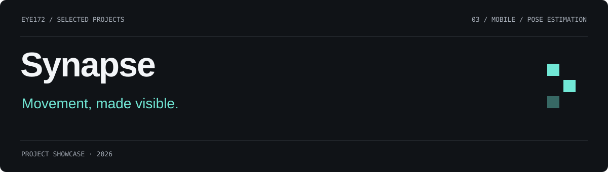
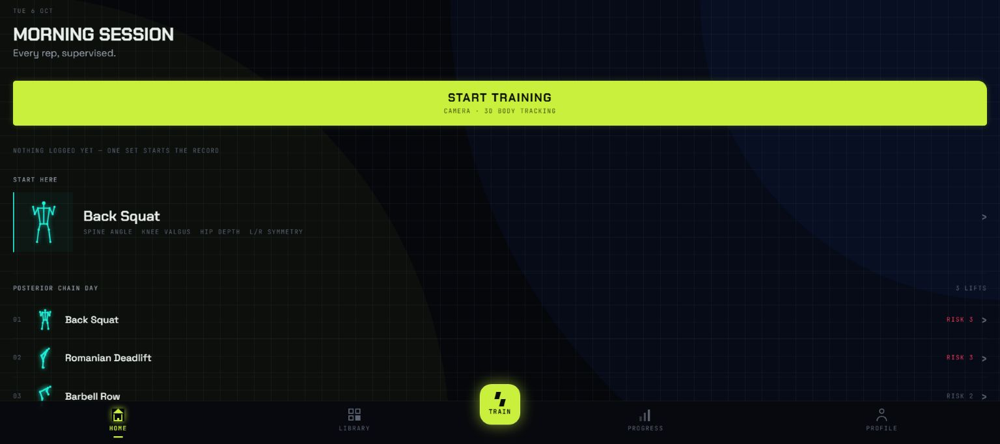
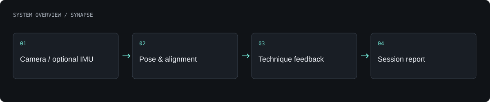

# Synapse

An exercise-analysis application combining camera pose tracking, movement metrics and optional wearable IMU input.

**Android and web prototype · active development**

[What is built](#what-is-built) · [Architecture](#architecture) · [Authors](#authors) · [Profile](https://github.com/Eye172) · [Source code](https://github.com/Eye172/synapse-app-v1)

## Product gallery

Screenshot of the local application interface.

## What is built

- Track body pose through a native Android camera pipeline and MediaPipe.
- Display a body-aligned 3D representation and technique feedback.
- Count repetitions and record movement metrics for training sessions.
- Support an optional five-IMU rig over Wi-Fi/UDP in the Android workflow.

## Architecture

The application separates sensor input, pose processing, movement grading and presentation. Android native camera modules feed the shared application workflow; optional rig data complements camera measurements. The browser version has a camera workflow without UDP rig support.

**Technology:** React Native · Expo · TypeScript · Kotlin · CameraX · MediaPipe.

## Current scope

A software prototype under development. Hardware integration and field evaluation are ongoing; camera and sensor availability depend on the platform and build.

## Authors

**Synapse team**, including [Shakhnazar Akhmer](https://github.com/Eye172).

## About this repository

This is a standalone project showcase containing a product description, visuals and a high-level architecture overview. The implementation is available in the linked source repository. No deployment is required to explore this page.

[Contact](mailto:shakh090909@gmail.com) · [GitHub profile](https://github.com/Eye172)
